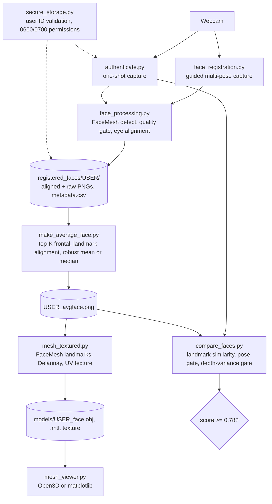

# 3D Face Modeling and Authentication (MediaPipe + OpenCV)

[](https://github.com/ks1686/Machine-Vision-Project/actions/workflows/test.yml)
[](LICENSE)

Graduate Machine Vision course project (Fall 2025): face modeling and verification with a standard RGB webcam, no depth sensor. A guided capture collects aligned face crops from several head poses, the sharpest frontal crops are averaged into one face texture, and MediaPipe FaceMesh landmarks turn that texture into a textured 3D mesh. Authentication captures one live frame and compares its 478 FaceMesh landmarks with each registered user's averaged face.

The project proposal is in [`Proposal/`](Proposal/).

## Architecture



## Setup

Requires Python 3.12 and [uv](https://docs.astral.sh/uv/).

```bash
uv sync --group dev
```

The pipeline uses MediaPipe's legacy FaceMesh solution API. It is pinned to MediaPipe 0.10.21 (`>=0.10.21,<0.10.30`), which also holds NumPy on 1.x, OpenCV on 4.x, SciPy on 1.17, and protobuf on 4.x. See [docs/dependency-notes.md](docs/dependency-notes.md) for the reasoning. On Linux, OpenCV and Open3D need system GL libraries (`libgl1`, `libegl1`, `libglib2.0-0`).

Run scripts with `uv run python <script.py> ...`.

## Usage

User IDs may contain letters, digits, `_`, `-`, and `.` (not leading), up to 64 characters. Spaces become `_`. Anything else is rejected.

### 1. Register (webcam)

```bash
uv run python face_registration.py <USER_ID>
```

Follow the on-screen prompts (straight, right, up, left, down, tilt right, tilt left; two rounds). Frames that pass the blur, brightness, and face-size checks are eye-aligned to 512x512 and saved to `registered_faces/<USER_ID>/`, with the raw frame in `raw/` and one row per capture in `registered_faces/metadata.csv`. Press SPACE to force a capture, `q` to stop.

Validate a capture set:

```bash
uv run python check_capture.py <USER_ID>
```

### 2. Average face

```bash
uv run python make_average_face.py <USER_ID>
```

Takes up to 24 of the sharpest straight-ahead captures, aligns them to the sharpest one with FaceMesh landmarks, drops rotation and reprojection outliers, and writes the sharper of a sigma-clipped mean and a median to `registered_faces/<USER_ID>/<USER_ID>_avgface.png`.

### 3. Textured mesh

```bash
uv run python mesh_textured.py <USER_ID>
```

Writes `models/<USER_ID>_face.obj`, `.mtl`, and `_face_texture.png`. The OBJ opens in Blender, MeshLab, or any 3D tool.

### 4. View

```bash
uv run python mesh_viewer.py <USER_ID> --file models/<USER_ID>_face.obj
```

Add `--no_flip` if the model appears upside down.

### 5. Authenticate (webcam)

```bash
uv run python authenticate.py [USER_ID]
```

With a user ID it verifies that identity; with none (press Enter at the prompt) it finds the best match among registered users. Press SPACE when the face box is green, `q` to quit. The exit verdict is a failure if no user reaches the threshold or if a different user than the requested one matches.

How the comparison works (`compare_faces.py`):

- Landmarks are extracted from the aligned live frame and from each user's averaged face, centered, and scale-normalized.
- Head pose (yaw, pitch) is estimated from the landmarks. A pose difference over 30 degrees scores 0; smaller differences reduce the score.
- The score is a linear map of landmark similarity into `[0, 1]`. A match needs at least `0.78` (`MIN_CONFIDENCE`).
- If the live frame's FaceMesh depth variance is below `0.003`, it is rejected as a possible flat photo.

Limitations: the depth values are MediaPipe's estimate from a single RGB frame, not measured depth, so the depth-variance gate is a heuristic and not a reliable anti-spoofing or liveness check. Matching uses landmark geometry only; the 3D mesh is a visualization output and is not used for authentication. The threshold has not been calibrated on a labeled dataset in this repository.

## Biometric data handling

Everything stays local; nothing is uploaded.

- `registered_faces/`, `models/`, and `auth_images/` hold face images, landmark meshes, and capture metadata. They are listed in `.gitignore` and must never be committed.
- On POSIX systems these files are written owner-only (`0600`) inside owner-only directories (`0700`).
- Every authentication attempt saves the raw and aligned capture to `auth_images/`. Delete them when no longer needed.
- To remove a user, delete `registered_faces/<USER_ID>/`, that user's rows in `registered_faces/metadata.csv`, and `models/<USER_ID>_face.*`.

## Files

| File | Purpose |
| --- | --- |
| `face_processing.py` | FaceMesh detection, quality checks, eye alignment, saving captures and metadata |
| `secure_storage.py` | User ID validation and owner-only file and directory permissions |
| `face_registration.py` | Guided multi-pose webcam capture |
| `check_capture.py` | Verifies aligned, raw, and metadata counts and geometry for a user |
| `make_average_face.py` | Builds the averaged face texture |
| `mesh_textured.py` | Builds the textured OBJ mesh |
| `mesh_viewer.py` | Views meshes and point clouds |
| `authenticate.py` | One-shot capture and verification |
| `compare_faces.py` | Feature extraction, pose estimation, scoring, model discovery |

## Development

```bash
uv run pytest
uv run ruff check . && uv run ruff format --check .
```

Tests use synthetic frames and landmarks and need no webcam. GitHub Actions runs ruff and pytest on every push and pull request (`.github/workflows/test.yml`).

## License

MIT. See [LICENSE](LICENSE).
